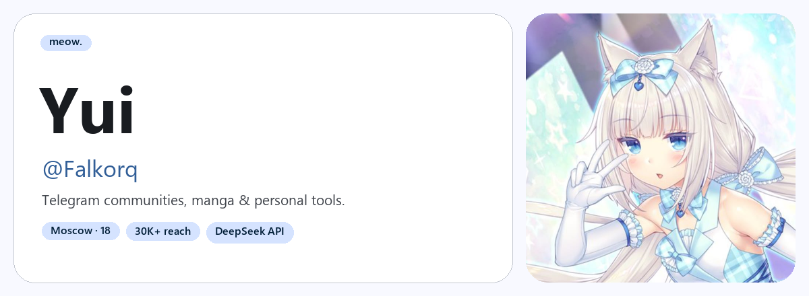

<picture>
  <source media="(prefers-color-scheme: dark)" srcset="./assets/banner-dark.png">
  
</picture>

I build things for myself: small apps, bots, and tools that make everyday life easier.
I work with AI APIs, mostly DeepSeek, and sometimes swap code for After Effects and Photoshop.

Most of my projects are private. Catgirls and Material Design 3 are very much public interests.

### Code & tools

AI integrations: **DeepSeek API**.

### On repeat

### Find me

-  [@falkorq](https://t.me/falkorq)
-  **nyuriri**
-  [qq@nyaaa.moe](mailto:qq@nyaaa.moe)

Badges by <a href="https://github.com/ziadOUA/m3-Markdown-Badges">ziadOUA / m3-Markdown-Badges</a>.
